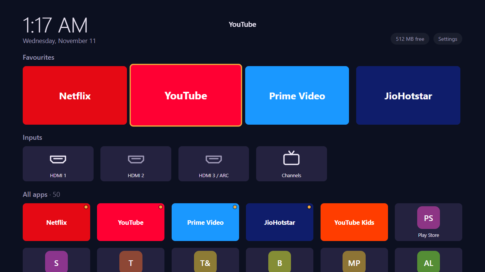
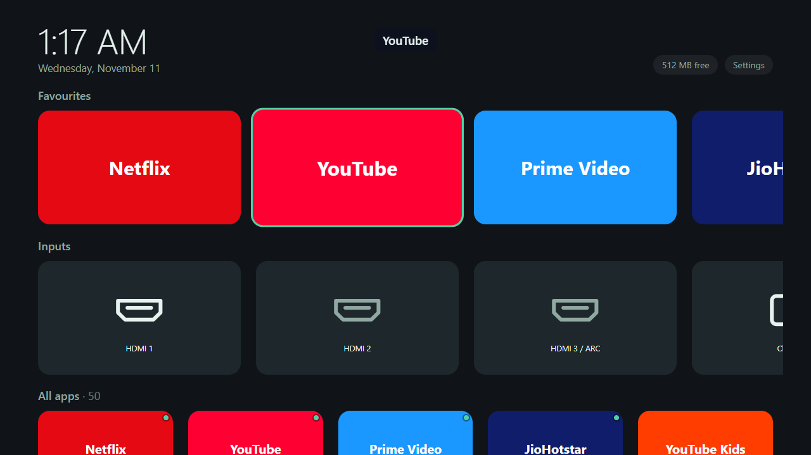
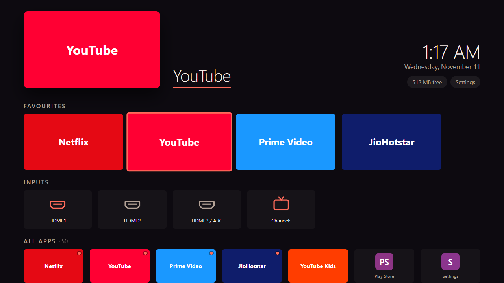
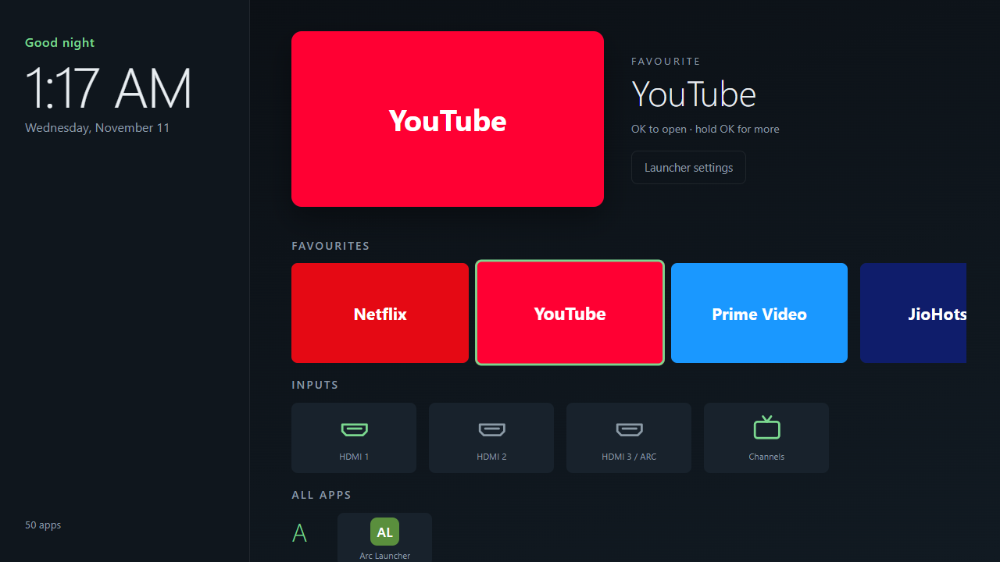

# Web TV Launcher

A light home screen for Android TV and Google TV. Its whole UI is plain HTML, CSS and JavaScript in a small Kotlin
WebView shell, so anyone who can build a web page can **reskin the TV**, and every skin is checked against a
performance budget before it reaches a TV.

| Default | Minimal |
|---|---|
|  |  |
| **Marquee** | **Shelf** |
|  |  |

**Version 1.1.0** · Android 7+ (minSdk 24) · built and measured on a Sony Bravia VU31 (Google TV, Android 14, 2 GB RAM)
· MIT licence

## Why use it
- **Skins are web pages, with no build step.** Four levels: colour and size tokens, CSS for the stable components,
  a layout file, or your own sandboxed page with JavaScript (frameworks allowed). Editor types (`lx.d.ts`) without
  a compiler. → [skin-api.md](docs/skin-api.md)
- **Skins can't hurt the TV or the user.** They have no network, can't call the native bridge, and can launch only
  apps the core gave them, and only when the user presses OK. A runtime guard returns to the default skin when a
  skin hangs, crashes, janks or uses too much memory. Hold **Back** for 5 s for safe mode. → [SECURITY.md](SECURITY.md)
- **A performance budget with numbers.** `lx lint` (file and image sizes, CSS rules, idle animation) and
  `lx bench --tv` (janky frames per key, p95 frame, key latency, cold start and memory, relative to the default skin on
  the same TV) give every skin a score and a tier: Lite, Standard or Rich.
- **Fast skin work on a real TV.** `lx dev --tv` installs and shows the skin on every save, in about 1 s.
  `lx pack` makes a `.lxskin` file; users install it from a phone (LAN page and PIN), a link, a QR code, ADB or a
  gallery.
- **Small and quiet.** APK about 170 KB. No ads, no analytics, no account, no Google services. The network is used only
  to download skins the user asks for and for the LAN install page while it is on screen.
- **Gives memory back.** Hidden for 60 s, it frees its WebView; after 2 minutes it ends its process. Google TV's own
  home stays in memory.
- **Covers Google TV home without root.** After boot, after a wake from standby and on Home, through one accessibility
  switch that sees only Google TV home's window events. → [setup guide](docs/setup-guide.md)
- **Useful on its own:** favourites you can reorder, hidden apps, a Recent row, HDMI inputs, clock, settings export
  and import.

## Limits
- Google TV home shows for about a second before Web Launcher comes back (a key mapper app fixes it for Home).
- Idle memory is about the same as Google TV home on the VU31 (144–150 MB with the renderer, against about 136 MB);
  the gain is when it is hidden. Numbers: [development.md](docs/development.md#measuring-on-the-tv).
- WebView costs 25–30 ms on the first frame after each key on a Mali-G31; skins can't remove it.
- Web DRM is Widevine L3 only, so video stays in native apps. Not on Google Play.

## Install
**Everyone:** [Set up on your TV](docs/setup-guide.md), no computer needed. In short: install **Downloader** from the
Play Store, open `paulbennet.github.io/AndroidTVLauncher/apk` in it, install, open Web Launcher, and follow
**Set up this TV**.

**With ADB:** `adb install web-launcher.apk` from [Releases](../../releases), then **Set up this TV**, or the two ADB
commands in [development.md](docs/development.md#setting-up-a-tv-over-adb).

## Quick start for developers
Needs Node 20+, JDK 17 and the Android SDK (platform 34). Build and preview:
```bash
git clone https://github.com/paulbennet/AndroidTVLauncher && cd AndroidTVLauncher
npm ci && npx playwright-core install chromium   # tests and lx drive Chrome for Testing
npm test
node tools/serve.mjs          # preview with mock apps: http://localhost:5173/?apps=50 (&skin=shelf, &googletv)
./gradlew assembleRelease     # signed with the debug key unless keystore.properties exists
adb install -r app/build/outputs/apk/release/app-release.apk
```
Make a skin and try it on the TV:
```bash
node tools/lx.mjs new my-skin --level 2 --name "My skin"   # --level 3: your own sandboxed page
node tools/lx.mjs dev my-skin --open                        # live preview on the desktop
node tools/lx.mjs dev my-skin --tv 192.168.1.20:5555        # live on the TV over ADB
node tools/lx.mjs bench my-skin --tv 192.168.1.20:5555      # score and tier on the real TV
node tools/lx.mjs pack my-skin                              # my-skin-0.1.0.lxskin to share
```

## AI agents
The repo ships an agent skill, **`web-tv-launcher`**, for Claude Code, Codex, GitHub Copilot and other agents that
read `SKILL.md`. It walks non-engineers through TV setup step by step, helps engineers build and debug, covers the
whole skin life cycle (design, lint, bench, pack, publish, install, test, debug, maintain), includes a read-only TV
health check (`scripts/tv-doctor.sh`), and a method for problems nobody has documented yet.

| Agent | Install |
|---|---|
| Claude Code | `claude plugin marketplace add paulbennet/AndroidTVLauncher` then `claude plugin install web-tv-launcher@web-tv-launcher` |
| Codex | `codex plugin marketplace add paulbennet/AndroidTVLauncher` then `codex plugin add web-tv-launcher@web-tv-launcher` |
| Any agent (skills.sh) | `npx skills add paulbennet/AndroidTVLauncher` |
| GitHub CLI | `gh skill install paulbennet/AndroidTVLauncher web-tv-launcher --agent claude-code` (or `codex`, `github-copilot`, …) |
| In a clone | Agents read [AGENTS.md](AGENTS.md) (and `CLAUDE.md`), which point to the skill |

The skill lives in [skills/web-tv-launcher/](skills/web-tv-launcher/SKILL.md); manifests: `.claude-plugin/`,
`plugin.json`, `.codex-plugin/`, `.agents/plugins/`.

## Documentation
| | |
|---|---|
| [setup-guide.md](docs/setup-guide.md) | Set up on a TV, in plain words |
| [skin-api.md](docs/skin-api.md) | Making skins: levels, manifest, layout, level 3 SDK, budget, bench, gallery |
| [development.md](docs/development.md) | Code layout, build, signing, ADB setup, memory, measuring, technical limits |
| [gotchas.md](docs/gotchas.md) | Google TV, WebView, remote and measuring traps we hit |
| [design-rules.md](docs/design-rules.md) | What is cheap and what is expensive to draw on a TV |
| [launcher-v1-plan.md](docs/launcher-v1-plan.md) | Design, decisions, milestones and progress |
| [research-webview-launchers.md](docs/research-webview-launchers.md) | Prior art and the targets that came from it |

## Contributing
Issues only: bug reports, ideas and skin questions are welcome ([CONTRIBUTING.md](CONTRIBUTING.md)). Pull requests are
off. Licence: MIT ([LICENSE](LICENSE)); third-party parts: [THIRD_PARTY_NOTICES.md](THIRD_PARTY_NOTICES.md).
