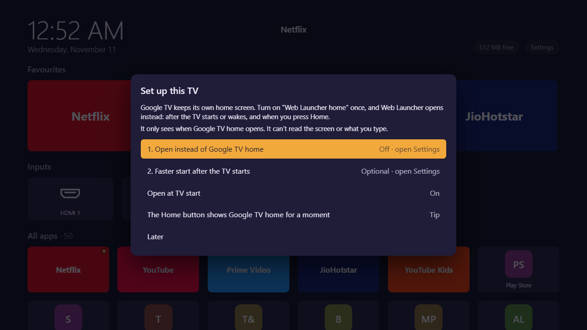
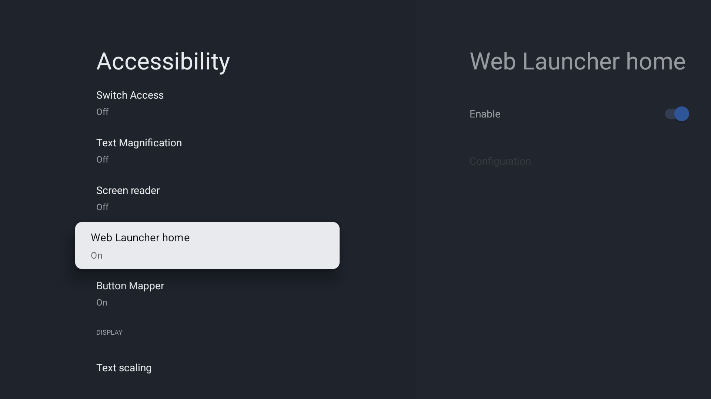
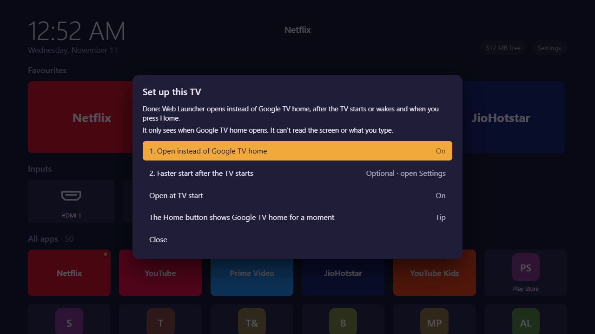

# Set up Web TV Launcher on your TV

You need only the TV and its remote. It takes about 5 minutes. No computer is needed.

Made for Google TV and Android TV with Android 7 or newer. Tested on a Sony Bravia (Google TV, Android 14); other TVs
may show slightly different Settings screens.

## 1. Install the app
1. On the TV, open the **Play Store**, search for **Downloader** (by AFTVnews) and install it.
2. Open **Downloader**. In the address box, type:

   **`paulbennet.github.io/AndroidTVLauncher/apk`**

   Then pick **Go**.
3. The TV asks if Downloader may install apps. Pick **Settings**, turn **Downloader** on, and press **Back**.
4. Pick **Install**, then **Done**. Downloader may offer to delete the file: pick **Delete**, it is not needed any
   more.

> Some TVs call step 3 "Unknown sources" or "Install unknown apps" (Settings → Apps → Security & restrictions).

## 2. Open it and turn on "Web Launcher home"
Google TV always keeps its own home screen. One switch makes Web Launcher open instead: after the TV starts, after it
wakes up, and when you press **Home**.

1. Open **Web Launcher** (Apps → Web Launcher). The first time, it shows **Set up this TV**:

   

2. Pick **1. Open instead of Google TV home**. The TV's Accessibility settings open.
3. Go down to **Services** and pick **Web Launcher home**. Turn on **Enable**. If the TV asks, pick **OK** or
   **Allow**.

   

4. Press **Back** until Web Launcher is on screen again. Step 1 now shows **On**:

   

**Is this safe?** Android shows a strong warning for every accessibility service. Web Launcher home is built to see
one thing only: that Google TV's home screen opened. It can't read the screen, what you type, or other apps, and it
sends nothing anywhere. The source code is public: `app/src/main/java/com/weblauncher/tv/HomeWatchService.kt`.

## 3. Optional
- **2. Faster start after the TV starts:** pick it, pick **Web Launcher**, and allow **Display over other apps**.
  Web Launcher then opens a little sooner after the TV starts.
- **The Home button:** with step 1 on, Home shows Google TV home for about a second, then Web Launcher. To skip that,
  install a button-mapping app, for example **Button Mapper** from the Play Store, and set **Home → Web Launcher**.

You can open this screen again at any time: hold **OK** on any app → **Launcher settings** → **Set up this TV**.

## Using it
- **Arrows** move, **OK** opens an app, **hold OK** opens the app menu: favourites, move, hide, app info.
- **Back** or **Home** goes back to the first favourite.
- **Launcher settings → Skin** changes the look. **Install skin** adds new skins from your phone or a link.

## If something goes wrong
| Problem | What to do |
|---|---|
| Google TV home stays on screen | Check **Set up this TV**: step 1 must say **On**. Turn it on again if it is off. |
| Step 1 was on, now it is off | Android turns the service off when the app is force-stopped (Settings → Apps → Web Launcher → Force stop) or cleared. Turn it on again. |
| A skin looks wrong or is slow | Hold **Back** for 6 seconds: Web Launcher opens with the default skin. |
| Downloader says the link doesn't work | Check the address letter by letter, with capitals as shown: `paulbennet.github.io/AndroidTVLauncher/apk`. |
| Anything else | Open an issue: https://github.com/paulbennet/AndroidTVLauncher/issues — say which TV you have. |

## Remove it
Settings → Apps → **Web Launcher** → **Uninstall**. Google TV home is back at once.
